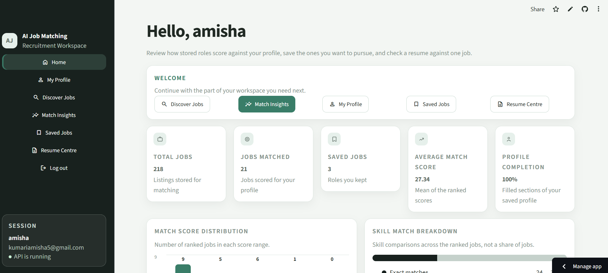
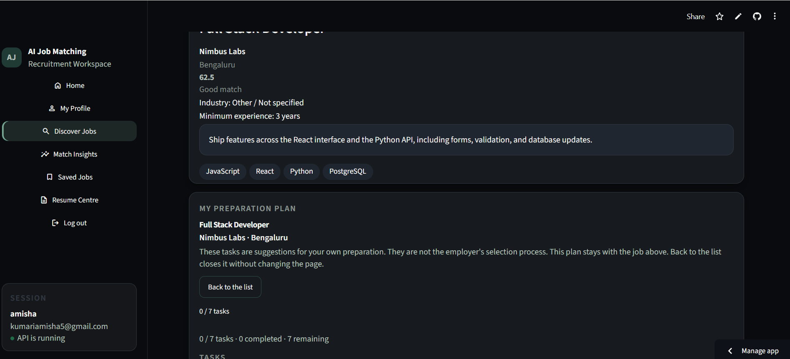
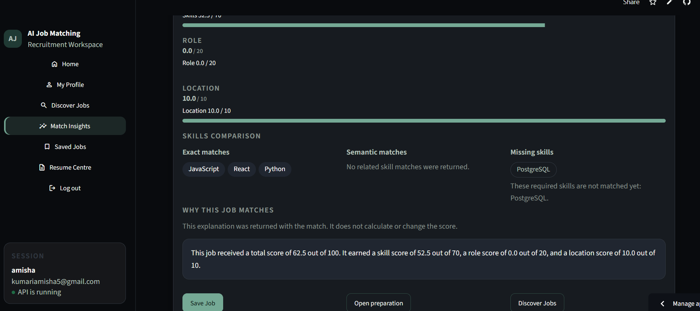
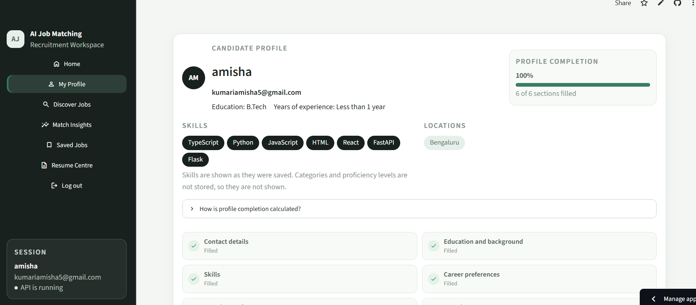
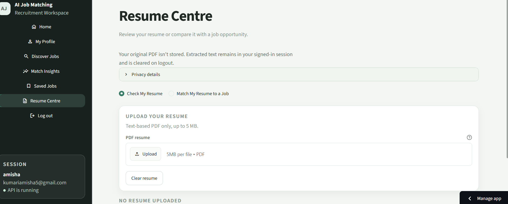
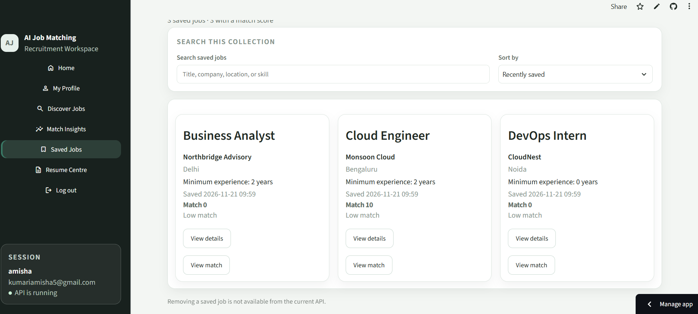
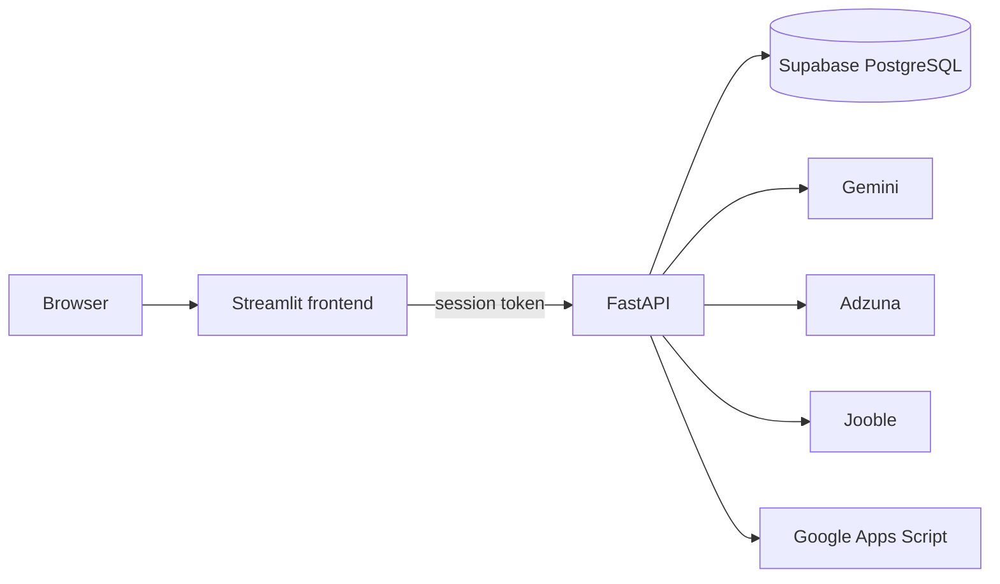
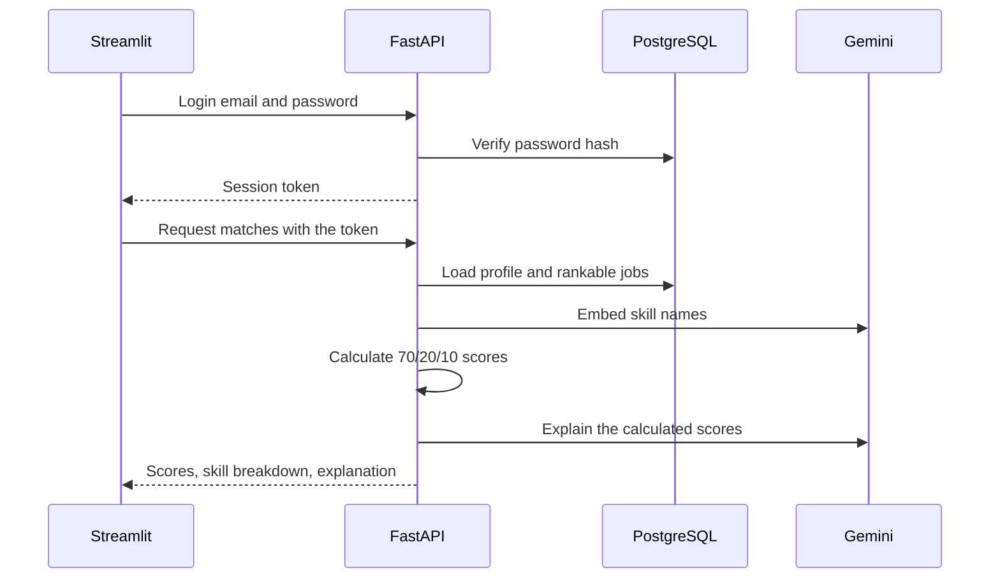

# AI Job Matching Agent

An AI-assisted job discovery application for one signed-in candidate. It stores a structured profile, searches job listings, and ranks the listings that have verified skill requirements. The match score is a fixed 70/20/10 formula. Gemini embeds skill names and writes explanations of scores the application has already calculated.

The candidate can review a PDF resume in the current session, compare that text with one stored job, save stored listings, and keep a preparation checklist for a stored job.

| | |
| --- | --- |
| Live application | [ai-job-matching-agent-i7eclqklwezmqcxsxamgei.streamlit.app](https://ai-job-matching-agent-i7eclqklwezmqcxsxamgei.streamlit.app/) |
| API | [ai-job-matching-api.onrender.com](https://ai-job-matching-api.onrender.com) |
| Source | [github.com/amiisha11/AI-Job-Matching-Agent](https://github.com/amiisha11/AI-Job-Matching-Agent) |


Versions come from `runtime.txt` and `requirements.txt`.

## Screenshots

| Home | Discover Jobs |
| :---: | :---: |
|  |  |

| Match Insights | My Profile |
| :---: | :---: |
|  |  |

| Resume Centre | Saved Jobs |
| :---: | :---: |
|  |  |

## Features

### Authentication

- Registration, login, and logout.
- Passwords are stored as salted PBKDF2-HMAC-SHA256 hashes (600,000 iterations). The hash is never returned.
- Sessions last 12 hours. The browser keeps a random token in the `aj_session` cookie. The database stores only the SHA-256 hash of that token.
- Account setup emails a six-digit code to a profile that does not yet have a password. The code expires in 10 minutes.
- Forgot password uses a separate code and a separate table. A setup code cannot reset a password, and a reset code cannot create the first password.
- Change password requires the current password. Other sessions for that account are revoked. The current session stays signed in. A completed reset revokes every session.
- OTP requests wait 60 seconds between sends, allow 3 sends per email in 15 minutes, and allow 10 sends from one IP in that same window. Five failed checks lock further OTP checks for 15 minutes. That lock does not block password login.
- Production does not return the code in the API response. A code is shown on screen only when `APP_ENV=development` and `EMAIL_OTP_DEV_MODE=true`.

### Home

The signed-in home page reads the candidate's matches and saved jobs from the API. It shows match summaries, skill insights from those results, top matching jobs, recently saved jobs, and links into the other sections.

### Profile

My Profile edits one saved record: name, education, optional degree and institution fields, skills, preferred roles, industries, locations, countries, remote preference, and years of experience. The login email is not changed from this form. Completion is the share of six saved sections that have a value. Industry and remote preference are stored. They do not add match points.

### Discover Jobs

Discover searches the stored catalogue and, for India or the United Kingdom, can also run a live Jooble search.

Stored Adzuna listings stay in PostgreSQL. They can be filtered, scored when they have skill requirements, saved, and given a preparation plan. Jooble results are returned for the current search. They are not inserted into `jobs`, and the save endpoint only accepts a stored job id.

Filters use the values a listing actually has. A missing salary, workplace, employment type, or category stays blank.

### Match Insights

For a rankable job, Match Insights shows the calculated total, the 70/20/10 breakdown, exact skills, related skills, and missing skills. Gemini can write an explanation of that breakdown. If Gemini is unavailable, the API returns a short local explanation and still keeps the calculated score.

### Saved Jobs

A candidate can save a stored job once. The list is that candidate's own rows, newest first. The API has no delete route for a saved job, so the interface does not offer removal.

### Resume Centre

The candidate uploads one text-based PDF of up to 5 MB. The file is read in memory. It is not written to disk or to the database. Logout clears the extracted text from the Streamlit session.

The health result is the share of eight checklist items that passed. It is not an applicant-tracking score and it does not claim an interview outcome.

Job comparison counts required skills found by exact wording. Related wording is shown separately and is not included in that percentage. Embedding, when it runs, receives short skill names only. The full resume is not sent to Gemini.

### Preparation Journal

Each stored job can have one plan for the signed-in candidate: tasks, notes, and a next action. Suggested tasks are created with the plan and cannot be deleted. Tasks the candidate adds can be deleted. There is no due date, priority, or task-text editor. Live Jooble results do not get a plan, because they are not stored jobs.

### Interface

The interface uses an Obsidian, Graphite, and Emerald Teal palette. Streamlit's own menu selects System, Light, or Dark. `base` is omitted in `.streamlit/config.toml` so that menu stays available. Layouts use the shared styles in `frontend/theme.py` and stack on narrower screens.

## Technology

| Area | Choice |
| --- | --- |
| Frontend | Streamlit 1.67.0 |
| API | FastAPI 0.165.0, Uvicorn |
| Database | PostgreSQL on Supabase, SQLAlchemy 2, psycopg 3 |
| AI | Google Gemini through `google-genai` |
| Job data | Adzuna API, Jooble API (`requests`) |
| Resume files | pypdf, read in memory |
| Email | Google Apps Script in production; SMTP when `EMAIL_PROVIDER` is `smtp` or unset |
| Tests | pytest |
| Hosts | Streamlit Community Cloud, Render |

Python 3.12.14 is pinned in `runtime.txt` and `render.yaml`.

## Architecture

Streamlit never opens the database. It sends the session token to FastAPI. FastAPI checks that token, reads and writes Supabase, and calls Gemini, Adzuna, Jooble, and the mail provider.



A signed-in request carries the bearer token. The API hashes it, loads `auth_sessions`, and rejects a missing, expired, or logged-out session. Profile, match, save, resume, and preparation routes then check that the candidate id in the URL is the signed-in candidate.



If the embedding call fails, scoring continues with exact skill matches only.

## Matching

The score is calculated in `backend/services/matching.py`. That module does not call Gemini and does not open the database. The maximum total is 100.

| Component | Weight | Rule |
| --- | ---: | --- |
| Verified skills | 70 | Share of required skills that match |
| Preferred role | 20 | All or nothing |
| Preferred location | 10 | All or nothing |
| Total | 100 | Sum of the three parts |

Exact skill comparison ignores case and extra spaces. A required skill that is not an exact match can count as related when Gemini has embedded both skill names and their cosine similarity is at least `GEMINI_SKILL_SIMILARITY_THRESHOLD`. That threshold is 0.75 when the variable is unset. Related credit is the similarity itself, not a full skill. Each required skill is paired at most once.

The role score is 20 when a preferred role equals the job title or appears inside it. Otherwise it is 0. The location score uses the same rule against the job location and the candidate's preferred locations. Blank preferences do not match.

A job is left out of ranked results when it is marked unmatchable, when the provider did not supply skill requirements, or when `required_skills` is empty. A category label does not make a job matchable. Preferred industries and remote preference do not add points.

Gemini does not choose the total. It supplies embeddings for the related-skill step and, separately, a written explanation of the score the formula produced.

## Job providers

### Adzuna

Import commands search India (`in`) and the United Kingdom (`gb`). Stored rows keep the title, company, location, description, required skills, minimum experience, source, external id, country, listing URL, posting time, matchability, and category label and tag when the provider supplied them.

During import, a salary amount is accepted only when Adzuna supplies a currency. Predicted salaries are ignored. Salary, employment type, and workplace are not columns on `jobs`, so a stored catalogue card does not show them. Missing values are not filled in.

Category labels and tags are mapped on the job API model. Discover can filter by the categories that are present.

Use of Adzuna data follows Adzuna's developer terms and attribution requirements. This project does not grant extra rights to redistribute the listings.

### Jooble

Live search uses a separate key and endpoint for each country: `https://in.jooble.org` with `JOOBLE_IN_API_KEY`, and `https://uk.jooble.org` with `JOOBLE_UK_API_KEY`. The same search is cached in the API process for 10 minutes. Each country is limited to 40 outbound calls per UTC day in that process. Neither the cache nor the listings are written to PostgreSQL.

Jooble rows can include salary, currency, and employment type when Jooble sends them. They have no stored category. They cannot be saved and they do not open a preparation plan.

## Database

| Table | Purpose |
| --- | --- |
| `candidates` | Profile, preference lists, experience, and password hash |
| `jobs` | Stored listings, source identity, matchability, and category |
| `saved_jobs` | One candidate-job pair, saved once |
| `auth_sessions` | Hashed session tokens and expiry |
| `email_setup_otps` | HMAC of an account-setup code |
| `email_reset_otps` | HMAC of a password-reset code |
| `otp_sends` | OTP request log used for rate limits |
| `otp_guards` | Failed OTP attempts and lockout |
| `preparation_plans` | Notes and next action for one candidate and one job |
| `preparation_tasks` | Checklist rows on a plan |
| `job_sync_logs` | One Adzuna import attempt, without credentials |
| `provider_categories` | Category catalogue used by import |

`claim_tokens` and `claim_guards` remain from an older claim-code flow. Account setup does not accept those codes.

Schema scripts add columns or tables. They do not delete candidate or job rows. Run one only when that part of the database is missing. Do not run it again on a database that already has the change.

```powershell
.\.venv\Scripts\python.exe backend\migrate_job_source.py
.\.venv\Scripts\python.exe backend\migrate_job_categories.py
.\.venv\Scripts\python.exe backend\migrate_candidate_profile.py
.\.venv\Scripts\python.exe backend\migrate_email_otp.py
.\.venv\Scripts\python.exe backend\migrate_password_reset.py
```

Starting the API also creates the authentication, OTP, and preparation tables if they are absent. That startup step does not rewrite candidate or job rows.

## Local setup

Install Python 3.12, Git, and a PostgreSQL database. Supabase is the intended hosted database. A local Postgres database also works if `DATABASE_URL` points at it.

From PowerShell:

```powershell
git clone https://github.com/amiisha11/AI-Job-Matching-Agent.git
cd AI-Job-Matching-Agent

py -3.12 -m venv .venv
.\.venv\Scripts\python.exe -m pip install -r requirements.txt
copy .env.example .env
```

Edit `.env` on your machine. Do not commit it. Replace the placeholders in `.env.example`. They are not working credentials.

Start the API from the `backend` directory:

```powershell
cd backend
..\.venv\Scripts\python.exe -m uvicorn main:app --host 127.0.0.1 --port 8001
```

`GET http://127.0.0.1:8001/` returns `{"status": "ok"}` when the process is up. Leave this terminal running.

In a second terminal, return to the project root and start Streamlit:

```powershell
cd ..
.\.venv\Scripts\python.exe -m streamlit run frontend/app.py --server.port 8501
```

`cd ..` applies when the second terminal is still in `backend`. If it is already at the project root, skip that line.

Open [http://127.0.0.1:8501](http://127.0.0.1:8501).

## Environment

`.env.example` lists every variable. Do not put real values in Git, in the README, or in `render.yaml`.

| Variable | Purpose |
| --- | --- |
| `DATABASE_URL` | SQLAlchemy URL. Use the `postgresql+psycopg://` driver prefix. |
| `GEMINI_API_KEY` | Google AI Studio key for embeddings and explanations. |
| `GEMINI_MODEL` | Explanation model. Blank uses `gemini-3.8-flash`. |
| `GEMINI_EMBEDDING_MODEL` | Embedding model. Blank uses `models/gemini-embedding-2`. |
| `GEMINI_SKILL_SIMILARITY_THRESHOLD` | Minimum cosine similarity for a related skill. Default 0.75. |
| `ADZUNA_APP_ID` | Adzuna application id. |
| `ADZUNA_APP_KEY` | Adzuna application key. |
| `JOOBLE_IN_API_KEY` | Jooble key for India. |
| `JOOBLE_UK_API_KEY` | Jooble key for the United Kingdom. |
| `CORS_ORIGINS` | Comma-separated browser origins. Blank allows the local Streamlit origins. |
| `APP_ENV` | `production` or `development`. Blank means production. |
| `EMAIL_OTP_DEV_MODE` | With `APP_ENV=development`, the API may return a code instead of emailing it. Ignored in production. |
| `EMAIL_OTP_PEPPER` | Secret mixed into the OTP HMAC. |
| `EMAIL_PROVIDER` | `google_apps_script` in production. `smtp` or blank uses SMTP. |
| `GOOGLE_APPS_SCRIPT_URL` | HTTPS web app URL. An address that is not HTTPS is ignored. |
| `GOOGLE_APPS_SCRIPT_SECRET` | Shared secret checked by the script. |
| `SMTP_HOST` | SMTP server, used only on the SMTP path. |
| `SMTP_PORT` | SMTP port. The example uses 587. |
| `SMTP_USERNAME` | SMTP username, if the server requires one. |
| `SMTP_PASSWORD` | SMTP password. |
| `SMTP_FROM_EMAIL` | From address. |
| `SMTP_USE_TLS` | Start TLS when not using implicit SSL. |
| `SMTP_USE_SSL` | Use implicit SSL. |

The Streamlit process reads two more values from the environment first, then from Streamlit secrets:

| Variable | Purpose |
| --- | --- |
| `API_URL` | FastAPI origin. When unset locally, this stays `http://127.0.0.1:8001`. |
| `COOKIE_SECURE` | Marks `aj_session` Secure. Leave unset for local HTTP. Set `true` on HTTPS. |

## Email

Production mail is a Google Apps Script web app. FastAPI POSTs JSON with the shared secret, the recipient, and the one-time code. The script sends the message. A failed Apps Script call does not fall back to SMTP.

SMTP remains available when `EMAIL_PROVIDER` is `smtp` or left empty, and `SMTP_HOST` and `SMTP_FROM_EMAIL` are set. Render's free plan blocks outbound SMTP, which is why production uses Apps Script.

The message says the code expires in 10 minutes. Subjects do not contain the code. Logs record a failure category, not the secret, the code, or the recipient.

## Deployment

The frontend and the API are separate services.

### Frontend

Streamlit Community Cloud is connected to this GitHub repository. It runs `frontend/app.py` with `runtime.txt` and `requirements.txt`, and it updates through that app's configured deployment workflow. A frontend-only change does not require a Render deployment.

Set the secrets in the Streamlit dashboard, not in Git:

```toml
API_URL = "https://ai-job-matching-api.onrender.com"
COOKIE_SECURE = true
```

### Backend

Render runs the web service in `render.yaml`: Python 3.12.14, `pip install -r requirements.txt`, and `uvicorn` on `0.0.0.0` and the platform `PORT`. The health check is `GET /`. Secret values are marked `sync: false` and are entered in the Render dashboard. `APP_ENV` is `production`, `EMAIL_OTP_DEV_MODE` is `false`, and `EMAIL_PROVIDER` is `google_apps_script`.

Auto-Deploy is disabled on the Render service. Backend changes, including API and schema changes, require a manual deployment in the Render dashboard. A frontend-only change does not.

Set `CORS_ORIGINS` to the Streamlit site origin. More than one origin can be comma-separated.

### Database

Supabase PostgreSQL is reached only through `DATABASE_URL` on the API. The Streamlit service does not receive that URL.

## Tests

From the project root:

```powershell
.\.venv\Scripts\python.exe -m pytest frontend backend/tests -q --tb=line --ignore=backend/tests/test_live_embeddings.py
```

`backend/tests/test_live_embeddings.py` calls the live Gemini embedding API. It is left out of the standard run so the suite does not need a key or a network call. Run that file on its own when you intend to use the live key.

The UI work in this repository was last verified with **247 passing tests** on the command above. Later edits can change that count.

## Security and privacy

- Passwords are salted PBKDF2 hashes. Session tokens and OTP codes are stored only as hashes.
- Setup and reset codes use separate tables, so one purpose cannot satisfy the other.
- Candidate routes reject a token that belongs to a different candidate.
- Secrets stay in `.env`, Render environment variables, or Streamlit secrets.
- Resume bytes and extracted text are not stored by the application. The full resume is not sent to Gemini.
- These controls reduce exposure. They are not a security certification.

## Known limitations

- A listing without structured skill requirements can appear in Discover and still have no match score.
- Jooble results last for the search. They are not a permanent catalogue, and they cannot be saved.
- Adzuna imports run from commands. There is no scheduled sync.
- Scores depend on the skill lists the provider supplied and on the skills the candidate saved.
- Salary, employment type, and workplace are omitted when the provider did not supply them. Those facts are not columns on the stored `jobs` table.
- Resume health and resume-to-job coverage are guidance. They do not predict ATS results or hiring decisions.
- Saved jobs cannot be removed through the current API.
- Preparation has no due dates or priorities, and suggested tasks cannot be deleted.
- Older claim-code tables are unused by Account setup.

## Possible next steps

These are not implemented:

- Greenhouse or Lever as additional sources.
- Scheduled catalogue sync.
- Richer skill extraction from descriptions that have no structured requirements.
- Deeper preparation tracking, such as dates or priorities, if the API grows those fields.

## License

See the repository owner for reuse terms. Third-party job content remains under the provider's own terms.
